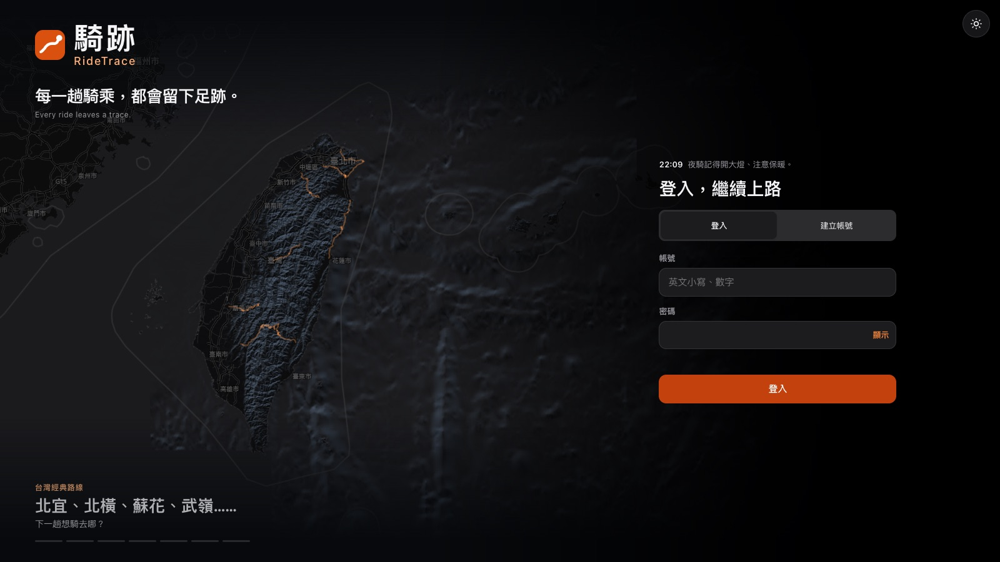
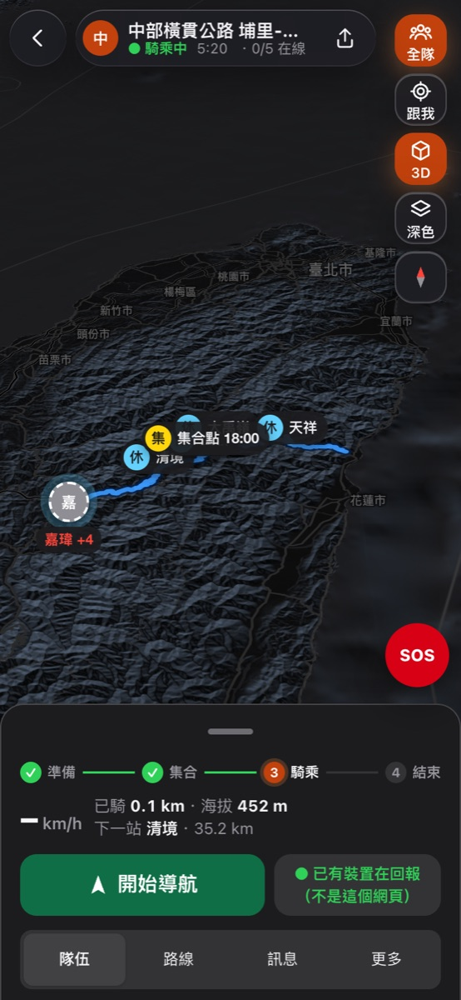
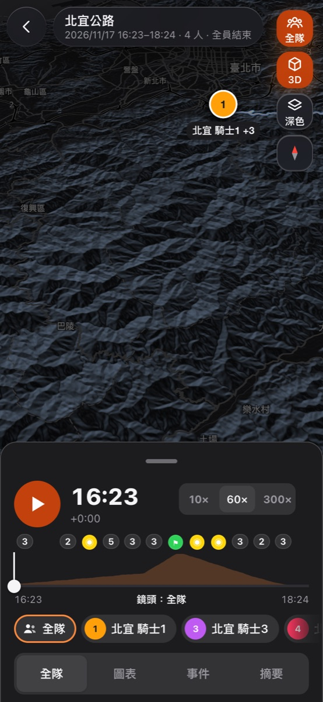
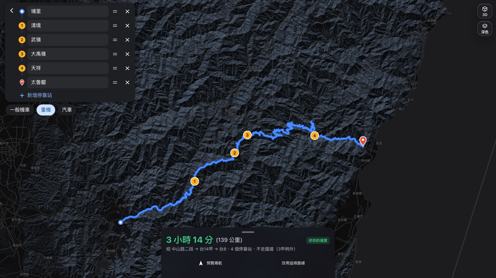
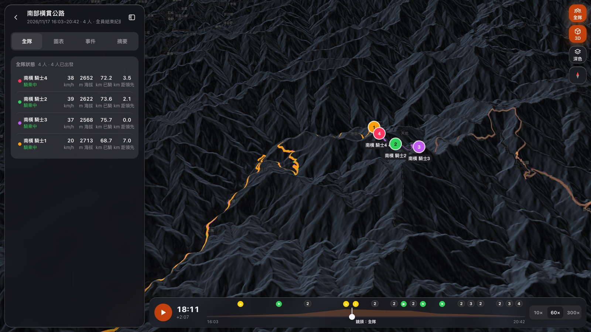
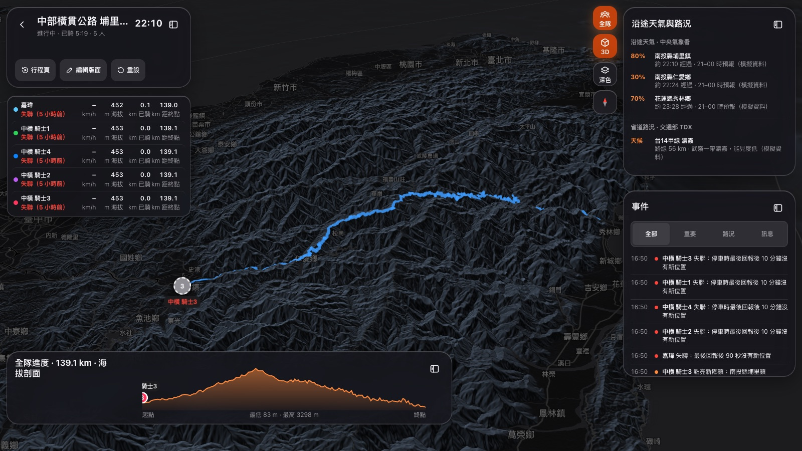
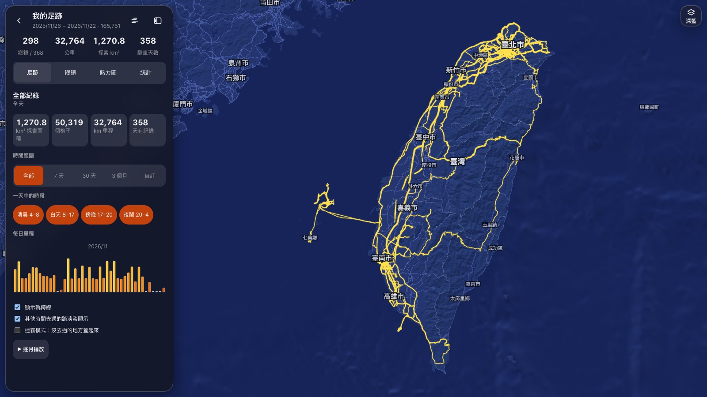
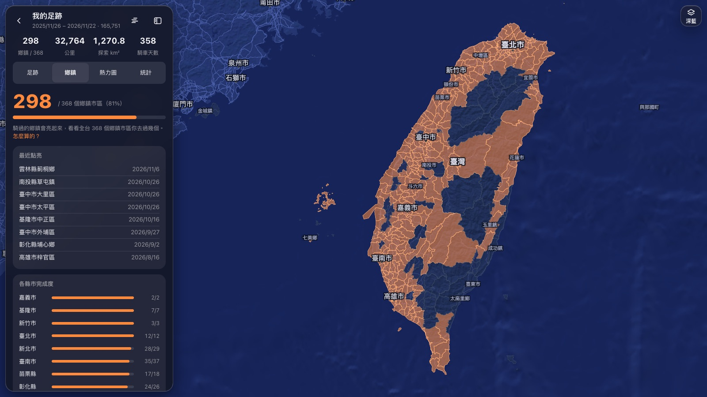
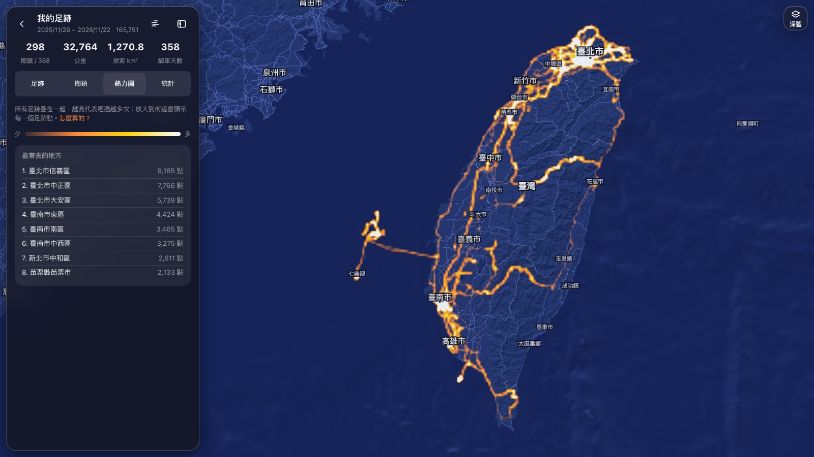
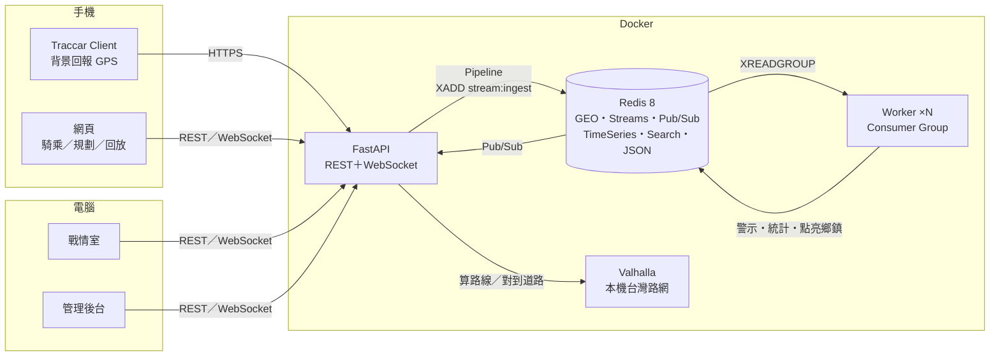

# 騎跡 RideTrace

[](https://github.com/chu-chia/ride-trace/actions/workflows/ci.yml)

**整隊一起出發，一個都不少。** 給機車車隊用的即時定位系統：騎車時每個人在地圖上看到全隊，有人落隊、失聯、偏離路線會自動通知；騎完可以整隊回放；長期累積成全年足跡、點亮全台 368 個鄉鎮。

這是北商資管系 DBMS 課程的 Redis 個人專題，重點是**用 Redis 的進階功能解決即時、地理、時間序列這幾類 SQL 不方便處理的問題**，前後端都是自己寫的。



**報告網頁**：<https://chu-chia.github.io/ride-trace/>（左邊講資料庫設計、右邊直接操作真的頁面，按 S 切成簡報；[手機版講稿](https://chu-chia.github.io/ride-trace/notes.html)）
**正式機**：<https://node.tail866fc3.ts.net:8443/>（可以自己註冊；[免登入看示範車隊](https://node.tail866fc3.ts.net:8443/demo)）

## 為什麼做這個

跟朋友騎山路最常發生的事：有人落隊沒人發現、在岔路走散、到了集合點不知道誰還沒到、回家後想看整趟只有各自零散的紀錄。騎跡想解決的就是這四件事：

1. **即時看到全隊**：手機回報位置，全隊每 2～3 秒更新
2. **自動警示**：落隊、失聯、偏離路線、異常久停、SOS、前方測速和路況
3. **整趟回放**：全隊同步播放，事件時間軸、速度和海拔曲線
4. **長期紀錄**：全年足跡、點亮鄉鎮、熱力圖

刻意不做速度排行榜，避免鼓勵飆車。

## 畫面

| 騎乘中（手機） | 回放（手機） | 規劃路線 |
|---|---|---|
|  |  |  |

**整隊回放**：時間軸上的圓點是事件（集合、落隊、抵達…），點了就跳過去。



**戰情室**：給在家或支援車上的人用大螢幕看全隊，3D 自動運鏡、隊員卡片、事件流、海拔剖面，右上是沿途天氣與路況。



**全年足跡與點亮鄉鎮**：用一整年的真實騎乘紀錄（16.5 萬個 GPS 點、358 天）。

| 全年足跡 | 點亮鄉鎮 | 熱力圖 |
|---|---|---|
|  |  |  |

## 功能

- **開團**：建立行程、邀請碼或 QR code 加入（24 小時自動失效）、隊員身分（騎士／只看／後援車）
- **規劃路線**：中文地點搜尋＋自動完成；機車／重機／汽車各自的路權（機車不上國道與快速道路）；1～3 條方案；用**你自己過去在各種路的實際速度**估時間；沿路線找加油站、機車行、公廁；沿途天氣（氣象署）與路況（交通部 TDX）
- **騎乘中**：即時地圖（2D／3D 地形、深色／淺色／衛星）、全隊進度條、轉彎提示、偏離路線自動重算、建立者改路線時其他人自動接回
- **警示與互動**：落隊（沿路線里程判斷，髮夾彎也不誤判）、失聯、抵達與全員到齊、前方測速、前方路況與降雨、SOS（長按）、快速訊息、聊天室、地圖標註坑洞；全部可以 Web Push 推到鎖定畫面
- **回放**：全隊同步、1～300 倍速、跟拍鏡頭、依隊員／速度／海拔上色、整趟摘要
- **長期紀錄**：全年足跡（迷霧模式、依日期和時段篩選、逐月播放）、點亮鄉鎮、熱力圖、累計統計
- **匯入舊紀錄**：上傳靈感足跡等 App 的 GPX、Google 地圖時間軸（Timeline.json／Records.json）、KML 或整包 ZIP，自動去重並重算鄉鎮與熱力圖
- **戰情室與管理後台**：大螢幕看全隊；後台看 Redis 狀態、每秒寫入、Pub/Sub 量、Worker 進度
- **背景回報**：網頁定位之外也支援 [Traccar Client](https://www.traccar.org/client/)（手機原生 App，鎖螢幕也能回報）

## Redis 用在哪裡

一筆 GPS 回報進來，API 用**一個 Pipeline** 一次送出十幾個指令：更新 GEO 位置、寫軌跡 Stream、寫 TimeSeries、更新心跳 TTL、Pub/Sub 推給全隊，再 `XADD` 交給背景 Worker 判斷警示。

| Redis 功能 | 在騎跡做什麼 | 換成 SQL 會怎樣 |
|---|---|---|
| **Pub/Sub** | 位置與事件即時推到每個人的瀏覽器（WebSocket） | 要一直輪詢資料庫 |
| **GEO** | 隊友距離、前方測速和坑洞（扇形查詢）、附近加油站 | 要另外裝 PostGIS |
| **Streams＋Consumer Group** | 軌跡、事件、聊天；Worker 分三組處理統計／警示／推播，處理完才 `XACK`，當掉的由 `XAUTOCLAIM` 接手 | 要自己做工作佇列和重試 |
| **TTL＋Keyspace Notification** | 心跳 90 秒沒更新就過期 → 觸發失聯警示；邀請碼 24 小時失效 | 要排程定時掃表 |
| **Lua Script** | 落隊、全員到齊「只通知一次」；統計依時間戳去重，重送不會重算 | 要鎖表或交易隔離 |
| **Transactions** | 開始行程用 `WATCH`＋`MULTI/EXEC` 樂觀鎖；踢人一次移出所有資料 | 可以做，但這裡 Redis 更輕 |
| **TimeSeries** | 回放的速度和海拔曲線；`TS.MRANGE … GROUPBY` 算個人在各種路的平均速度 | 要自己降採樣、分組聚合 |
| **RediSearch** | 15.6 萬筆地名中文搜尋＋自動完成；測速點條件查詢；GEOSHAPE 判斷一個點在哪個鄉鎮 | 全文搜尋和多邊形查詢都要外掛 |
| **RedisJSON** | 幾千個座標的路線，`JSON.GET … $.summary` 只取需要的部分 | 整包讀出來再解析 |
| **Sorted Set／Set** | 熱力圖計數（`ZINCRBY`）、迷霧格子（`SUNION`）、誰還沒到集合點（`SDIFF`） | 要 GROUP BY 和子查詢 |
| **RENAME＋WATCH** | 匯入舊紀錄時整份足跡在暫存 key 重建，再用一個交易 `RENAME` 換上；期間有新的 GPS 點寫入（`WATCH` 偵測到）就重來 | 要建暫存表、鎖表再換名 |
| **cache-aside＋`SET NX`** | 外部 API（TDX 每月 4,500 次）結果快取，鎖住只讓一個 Worker 去抓 | 要另外架快取 |

每個 key 的設計與理由：[docs/Redis功能對照.md](docs/Redis功能對照.md)。

## 資料庫設計

完整說明在 [docs/資料庫設計.md](docs/資料庫設計.md)（ER 圖、資料型別選擇、索引、ACID、持久化、資料量、Redis 不擅長的地方）。重點：

**先畫 ER 圖，再依「怎麼查」決定怎麼存。** Redis 沒有資料表、JOIN、外鍵，所以把關聯式的概念一一對應過來：

| 關聯式 | 騎跡的做法 |
|---|---|
| 一列資料 | Hash：`user:{uid}`、`trip:{tid}` |
| 主鍵 AUTO_INCREMENT | `INCR seq:user` |
| UNIQUE 約束 | `SET username:{name} {uid} NX`，搶不到就是帳號已存在 |
| 外鍵 | id 放進 key 名稱：`trip:{tid}:state:{uid}` |
| 多對多關聯表 | 兩個方向各一個 Set：`trip:{tid}:members`、`user:{uid}:trips` |
| 彙總表 | 寫入時就算好（反正規化）：`trip:{tid}:stats:{uid}` |
| 二級索引 | RediSearch `FT.CREATE`：中文全文＋TAG＋NUMERIC＋GEO＋GEOSHAPE |
| 時間索引 | Stream ID 就是毫秒時間戳，`XRANGE` 依時間查 |

**交易與一致性（ACID 對照）**

- **原子性**：`MULTI/EXEC` 與 Lua script。例如「全員到齊」：`SADD` 抵達名單 → `SDIFF` 算誰沒到 → `SET NX`，整段在一個 script 裡，兩個 Worker 同時判斷也只通知一次（SQL 要 `SELECT … FOR UPDATE`）。
- **隔離性**：Redis 單執行緒，指令依序執行；開始行程用 `WATCH` 樂觀鎖，被搶先改就重試。
- **持久性**：AOF（`appendfsync everysec`，類似交易日誌，最多掉 1 秒）＋RDB 快照（`save 300 10`）；`maxmemory-policy noeviction`，記憶體滿了寧可報錯也不刪資料。
- **At-least-once 與冪等**：Worker 處理完才 `XACK`，當掉時由別的 Worker `XAUTOCLAIM` 接手；統計依時間戳去重，重送不會重算里程。
- **Pipeline 不等於交易**：每筆 GPS 回報用 Pipeline 一次送出十幾個指令只是為了減少網路來回，刻意不包交易，避免拖慢高頻寫入。

**資料生命週期**：心跳、登入、邀請碼、快取都用 TTL 自己過期（SQL 要寫排程 `DELETE`）；工作佇列 `XADD … MAXLEN` 自動修剪；系統指標 TimeSeries 保留 7 天；軌跡與足跡永久保存。

**資料量**（開發機）：約 17 萬個 key、384 MB；地名與 POI 15.6 萬筆、測速照相 1,901 筆、鄉鎮多邊形 368 個；一位使用者的全年足跡 16.5 萬點。

**Redis 不擅長的**：臨時的報表查詢（沒有 JOIN／GROUP BY）、資料大了記憶體成本高、約束要自己寫。實務上會讓 Redis 處理即時資料，結束的行程再歸檔到 SQL 做分析。

## 系統架構



UML（用例圖、循序圖、活動圖、狀態圖、部署圖）：[docs/架構與UML.md](docs/架構與UML.md)。

## 技術

| 層 | 用了什麼 |
|---|---|
| 資料庫 | Redis 8（內建 Search、JSON、TimeSeries） |
| 後端 | Python 3.12、FastAPI、redis-py、Web Push（VAPID） |
| 前端 | 純 HTML＋ES module（沒有框架）、MapLibre GL JS 5、PWA |
| 路線 | [Valhalla](https://github.com/valhalla/valhalla)＋OpenStreetMap 台灣路網，跑在本機 |
| 地圖 | OpenFreeMap 底圖、AWS Terrain Tiles 地形 |
| 部署 | Docker Compose、GitHub Actions CI、Tailscale（HTTPS） |

**公開資料**：OpenStreetMap（路網、地名與 POI、鄉鎮界線，經 Geofabrik）、警政署測速執法設置點（政府資料開放平臺）、交通部 TDX 省道即時事件、中央氣象署鄉鎮天氣預報。

**隱私**：GPS 只送到自己的伺服器。路線計算和地圖比對用本機 Valhalla，不用 Google 或公開的路線服務；查天氣時只送縣市名稱，不送座標；推播內容端對端加密，不帶座標。個人軌跡資料（`data/`）不進版控。

## 自己跑起來

需要 Docker。

```bash
git clone https://github.com/chu-chia/ride-trace.git && cd ride-trace
cp .env.example .env          # 至少填 REDIS_PASSWORD（openssl rand -hex 24）
docker compose up -d --build redis api worker valhalla
open http://localhost:8750    # 註冊一個帳號就能開團
```

第一次啟動時 Valhalla 會下載台灣 OSM（約 330 MB）建路網，要 3～30 分鐘，在那之前規劃路線不能用。手機定位一定要 HTTPS。地名搜尋、測速點、鄉鎮界線的匯入方式，以及 GPS 模擬器（把真實騎乘片段當成多位隊友重播）、Traccar、推播、天氣和路況金鑰的設定，都在[開發者指南](docs/開發者指南.md)。

## 文件

| 文件 | 內容 |
|---|---|
| [開發者指南](docs/開發者指南.md) | 啟動、資料匯入、模擬器、各頁面網址、外部 API 設定 |
| [資料庫設計](docs/資料庫設計.md) | ER 圖、關聯式對應、型別選擇、索引、ACID、持久化、資料量 |
| [Redis 功能對照](docs/Redis功能對照.md) | 每個 Redis 功能用在哪個 key、為什麼 |
| [架構與 UML](docs/架構與UML.md) | 架構圖、用例圖、循序圖、活動圖、狀態圖、部署圖 |
| [部署](docs/部署.md) | Tailscale HTTPS、Windows 正式機、CI/CD |
| [Web Push 實作說明](docs/WebPush實作說明.md) | 推播流程與去重 |
| [開發紀錄](docs/records/) | 每天的交接與開發日誌 |
| [報告網頁規格](docs/報告網頁規格.md) | 報告網頁的定位、大綱、展示模式怎麼做（`report/`、`scripts/pages/`） |

## 作者

朱嘉瑋，國立臺北商業大學資訊管理系（DBMS 課程 Redis 個人專題，2026）。
