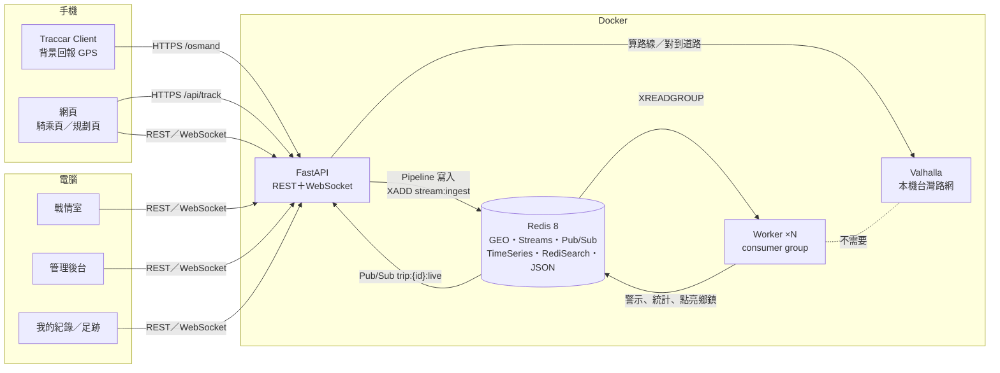
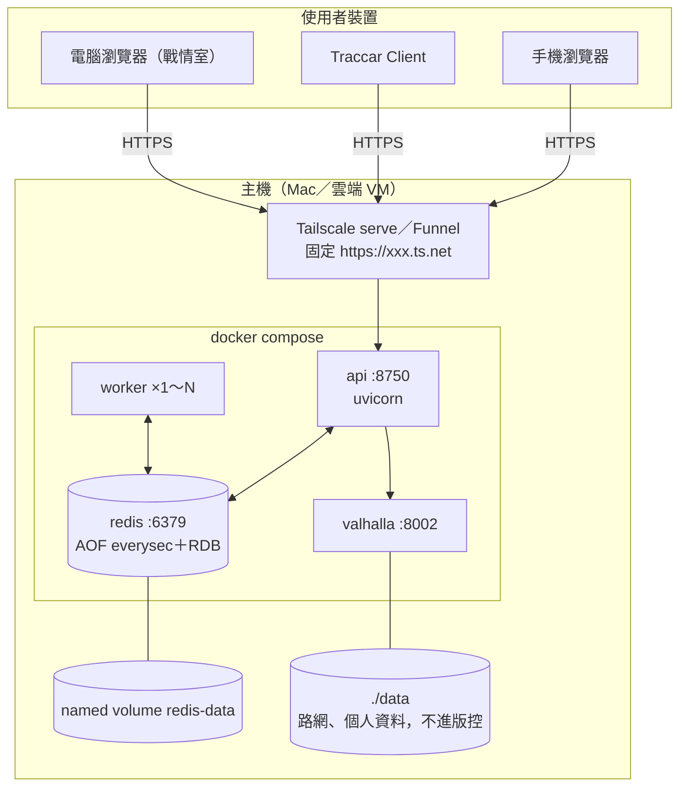
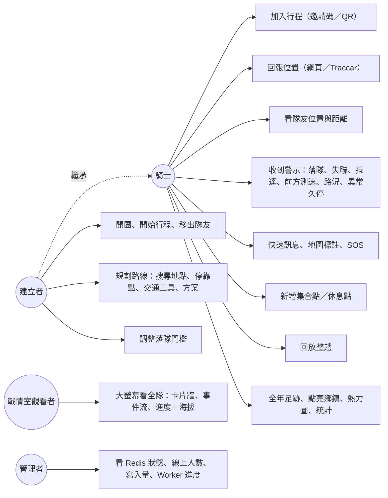
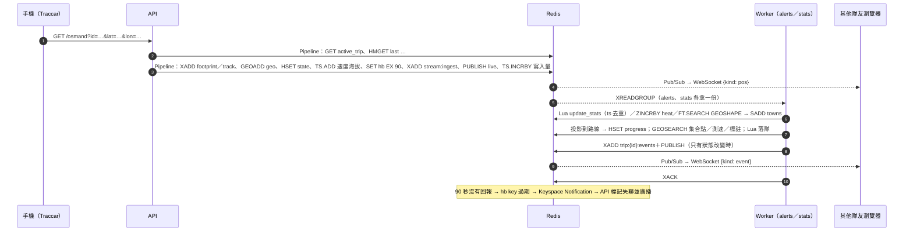
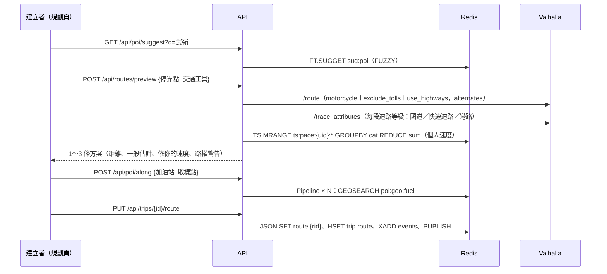
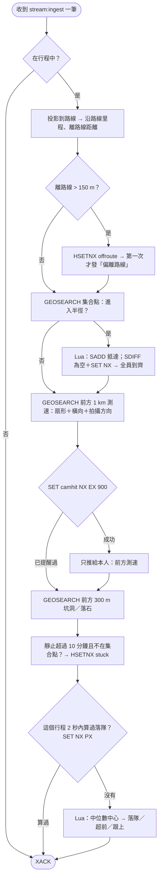
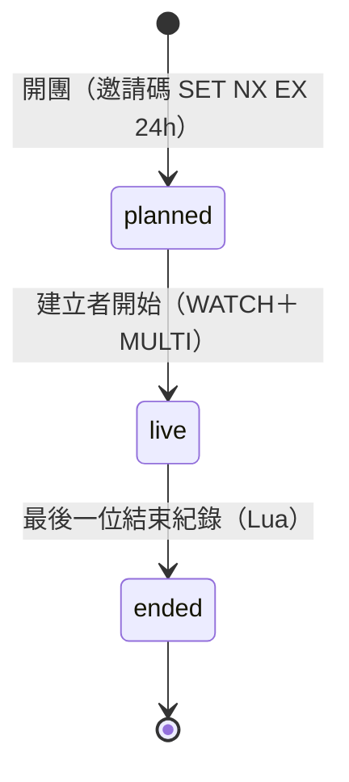
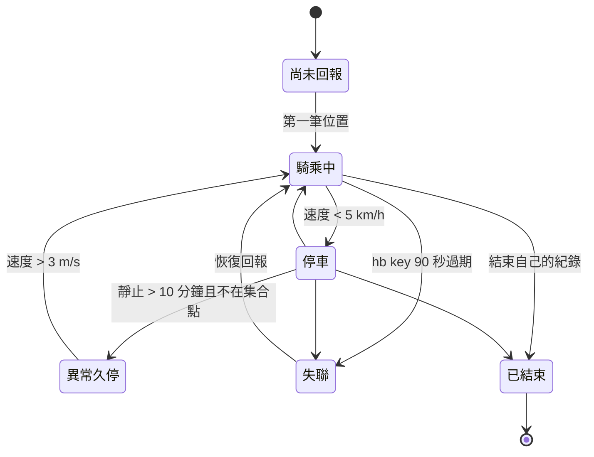
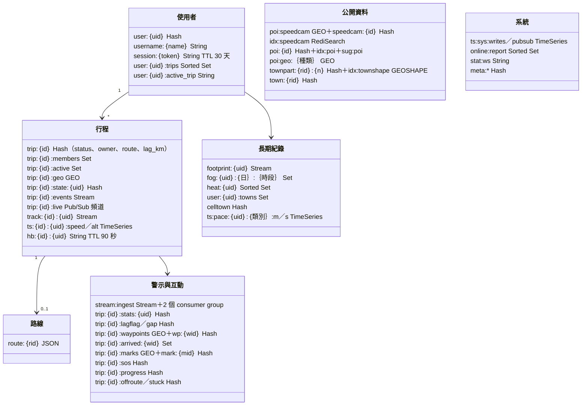

# 騎跡：架構與 UML

圖都用 Mermaid 寫，GitHub 會直接畫出來；要放進簡報可以貼到 <https://mermaid.live> 匯出 PNG／SVG。

---

## 1. 系統架構

公開資料都在本機匯入，查詢不送到外部服務：警政署測速執法設置點、OpenStreetMap（路網、地名與 POI、鄉鎮界線）。

## 2. 部署圖

## 3. 用例圖

## 4. 循序圖：一筆位置回報

## 5. 循序圖：規劃路線

## 6. 活動圖：騎乘中的警示判斷（worker alerts group）

## 7. 狀態圖：行程與隊員

## 8. Redis 資料模型（key 一覽）

