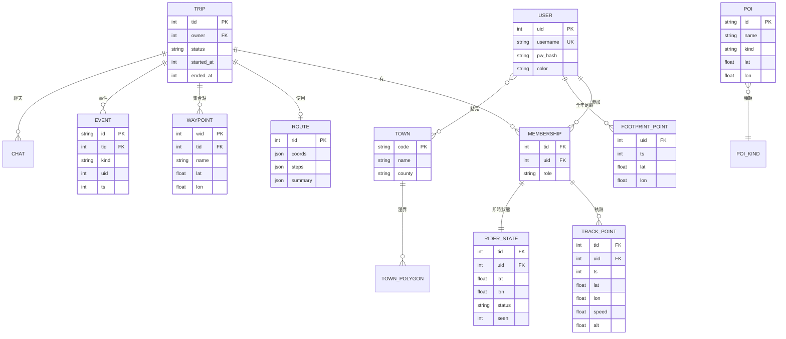

# 資料庫設計

騎跡只用一個資料庫：Redis 8（內建 Search、JSON、TimeSeries 模組），沒有另外接 SQL。這份文件從資料庫課程的角度說明：資料長什麼樣、關聯式的概念怎麼搬到 key-value、索引、交易與一致性、持久化，以及 Redis 不擅長、SQL 會比較好的地方。

每個 key 的詳細用途見 [Redis功能對照.md](Redis功能對照.md)。

## 1. 工作負載：為什麼選 Redis

| 特性 | 騎跡的情況 | 對資料庫的要求 |
|---|---|---|
| 寫入多、讀取少 | 每位騎士每 2～3 秒回報一次，一筆回報要更新位置、軌跡、速度、海拔、心跳、統計 | 單筆寫入要非常快，最好一次網路來回寫完 |
| 即時推送 | 位置要在 1 秒內出現在全隊的畫面上 | 資料庫本身能「推」，不能靠前端輪詢 |
| 地理查詢 | 隊友距離、前方 1 km 有沒有測速照相、這個點在哪個鄉鎮 | 內建空間索引 |
| 時間序列 | 回放要依時間取速度、海拔曲線，還要降採樣 | 依時間範圍查、聚合 |
| 會過期的資料 | 心跳、登入、邀請碼、快取 | 資料自己過期，不用排程刪除 |
| 背景工作 | 落隊、統計、推播交給 Worker，Worker 當掉不能掉資料 | 可靠的訊息佇列 |

這幾項關聯式資料庫都做得到，但要加 PostGIS、TimescaleDB、訊息佇列（RabbitMQ／Kafka）、快取（另一台 Redis）、排程器。Redis 一個服務就涵蓋，而且全部在記憶體中執行，單筆指令是微秒等級。

## 2. 概念模型（ER 圖）

先用關聯式的方式畫出實體，再看怎麼放進 Redis。



## 3. 從關聯式到 Redis：對應規則

Redis 沒有資料表、沒有 JOIN、沒有外鍵，所以設計方式跟 SQL 相反：**先想「要怎麼查」，再決定資料怎麼存**（query-driven design）。

| 關聯式的概念 | 在騎跡的做法 | 例子 |
|---|---|---|
| 資料表的一列 | 一個 Hash | `user:{uid}`、`trip:{tid}` |
| 主鍵（AUTO_INCREMENT） | `INCR` 計數器 | `INCR seq:user`、`INCR seq:trip` |
| 唯一鍵（UNIQUE） | `SET … NX` 搶占 | 註冊時 `SET username:{name} {uid} NX`，搶不到就是帳號已存在；邀請碼也一樣 |
| 外鍵 | 把 id 放進 key 名稱 | `trip:{tid}:state:{uid}`、`track:{tid}:{uid}` |
| 多對多關聯表 | 兩個方向各一個 Set | `trip:{tid}:members`（行程有誰）、`user:{uid}:trips`（我參加過哪些） |
| 一對多的子表 | 依查詢方式選型別 | 軌跡用 Stream（依時間）、集合點用 GEO（依位置）、事件用 Stream |
| 計算欄位、彙總表 | 寫入時就算好（反正規化） | `trip:{tid}:stats:{uid}`（里程、極速），Worker 每筆更新，讀的時候不用掃軌跡 |
| 檢視表、查詢快取 | 帶版本號的快取 key＋TTL | `cache:summary:{uid}:{ver}`，資料一變 `INCR fp:ver:{uid}`，舊快取自然失效 |

**key 命名**統一寫在 `backend/app/db.py` 的 `class K`，格式是「實體:id:子資料」，例如 `trip:57:state:24`＝行程 57 裡使用者 24 的即時狀態。這等於資料庫的 schema 文件。

## 4. 資料型別怎麼選

| 資料 | 型別 | 為什麼是這個型別 |
|---|---|---|
| 使用者、行程、即時狀態 | Hash | 一個物件多個欄位，可以只改一欄（`HSET`） |
| 全隊即時位置 | GEO | `GEOSEARCH` 直接找半徑內的隊友、測速、加油站 |
| 軌跡、事件、聊天、全年足跡 | Stream | 只會往後加、依時間讀；Stream ID 就是毫秒時間戳，等於免費的時間索引 |
| 速度、海拔、系統指標 | TimeSeries | 依時間範圍查、降採樣（`AGGREGATION avg`）、依標籤分組（`GROUPBY`） |
| 路線 | JSON | 幾千個座標加轉彎指示的巢狀結構，`JSON.GET … $.summary` 只讀需要的部分 |
| 成員、已抵達的人、點亮的鄉鎮、迷霧格子 | Set | 集合運算：`SDIFF` 誰還沒到、`SUNION` 合併多天足跡、`SADD` 回傳值判斷「第一次」 |
| 熱力圖、線上人數、推播排程 | Sorted Set | 依分數排序與範圍查詢：最常去的地方、最近 2 分鐘有回報的人、到期的推播 |
| 心跳、登入、邀請碼、鎖 | String＋TTL | 存在＝有效，過期＝自動刪除 |
| 背景工作佇列 | Stream＋Consumer Group | 可靠佇列：處理完才 `XACK`，沒確認的會被重新領取 |

## 5. 索引

| 索引 | 怎麼做 | 查詢 |
|---|---|---|
| 主鍵 | key 本身（雜湊表，O(1)） | `HGETALL trip:57` |
| 時間 | Stream ID＝時間戳；TimeSeries 本身依時間排序 | `XRANGE track:57:24 {開始} {結束}` |
| 空間（點） | GEO（底層是 geohash 當分數的 Sorted Set） | `GEOSEARCH poi:speedcam FROMLONLAT … BYRADIUS 1 km` |
| 二級索引（多欄位） | RediSearch `FT.CREATE`，自動索引指定前綴的 Hash | 見下方 |
| 空間（多邊形） | RediSearch GEOSHAPE | `FT.SEARCH idx:townshape "@shape:[CONTAINS $pt]"` |

RediSearch 的三個索引（schema）：

```text
idx:poi        ON HASH PREFIX poi:        LANGUAGE chinese
               name_n TEXT WEIGHT 2 | kind TAG | brand TEXT | rank NUMERIC SORTABLE | loc GEO
idx:speedcam   ON HASH PREFIX speedcam:   LANGUAGE chinese
               addr_n TEXT | city TAG | region TAG | limit NUMERIC SORTABLE | loc GEO
idx:townshape  ON HASH PREFIX townpart:
               code TAG | shape GEOSHAPE FLAT
```

一個查詢同時用到全文、標籤、數值範圍、地理四種條件，例如「南投縣、速限 40～60、地址含臺14、我附近 20 km 的測速照相」：

```text
FT.SEARCH idx:speedcam "@city:{南投縣} @limit:[40 60] @addr_n:臺14 @loc:[121.0 24.0 20 km]"
```

Hash 寫進去就自動進索引，不用另外維護，跟 SQL 的 `CREATE INDEX` 很像。

## 6. 交易、原子性與一致性

用 ACID 對照：

| ACID | Redis 的情況 | 騎跡怎麼用 |
|---|---|---|
| **原子性 Atomicity** | `MULTI/EXEC` 裡的指令一起執行；Lua script 整段原子執行 | 踢人：一次移出成員、GEO、心跳；結束紀錄：「移出＋檢查是否最後一人＋改狀態」用 Lua |
| **一致性 Consistency** | 沒有 CHECK、外鍵約束，要由程式保證 | 規則集中在 Lua script 與 `db.py`，不散在各處 |
| **隔離性 Isolation** | 單執行緒，指令一個一個執行，天生「可序列化」；`WATCH` 做樂觀鎖 | 開始行程：`WATCH trip:{tid}` → 檢查狀態 → `MULTI/EXEC`，有人搶先改了就重試 |
| **持久性 Durability** | 看設定，見第 8 節（AOF 每秒寫一次，最多掉 1 秒） | GPS 掉 1 秒可以接受；帳號等重要資料一樣有 AOF |

**競爭條件的例子**：兩個 Worker 同時判斷「全員到齊」，SQL 通常要 `SELECT … FOR UPDATE` 鎖住。騎跡用 Lua 把「`SADD` 抵達名單 → `SDIFF` 算還有誰沒到 → `SET allin NX`」放在同一段 script，Redis 單執行緒保證中間不會插進別的指令，所以全隊只會收到一次「全員到齊」。

**整批換資料（RENAME＋WATCH）**：網頁匯入舊紀錄時，比現有最後一筆還舊的點沒辦法直接 `XADD`（Stream ID 必須遞增），所以 worker 把整份足跡在暫存 key（`imp:{job}:…`）重建好，再 `WATCH footprint:{uid}` → `MULTI` → 一連串 `RENAME` → `EXEC` 一次換上。讀取的人不會看到一半新一半舊；換上前如果有新的 GPS 點寫進來，`WATCH` 會讓交易失敗，重新合併再試，剛回報的點不會被蓋掉。這跟 SQL「建新表、填資料、在交易裡 RENAME TABLE」是同一招。實測 30 萬點的 GPX（24 MB）約 9 秒完成。

**Pipeline 不等於交易**：每筆 GPS 回報用 `pipeline(transaction=False)` 一次送出十幾個指令，目的是減少網路來回，不保證原子性。這裡刻意不用交易，因為位置、軌跡、速度彼此獨立，有一個失敗不該拖累其他的，而且交易會讓高頻寫入變慢。

**At-least-once 與冪等**：Worker 處理完才 `XACK`，當掉時別的 Worker 用 `XAUTOCLAIM` 接手，所以同一筆可能被處理兩次。統計的 Lua 會記住「處理過的最後時間戳」，比它舊的直接略過，重送也不會重算里程（冪等）。推播用 `SET push:sent:{事件}:{收件人} NX` 去重。

## 7. 資料生命週期

| 資料 | 怎麼清 |
|---|---|
| 心跳 `hb:` | TTL 移動中 90 秒、停著（< 5 km/h）10 分鐘；過期會觸發 Keyspace Notification → 失聯警示 |
| 登入 `session:`、邀請碼 `invite:` | TTL 24 小時 |
| 集合前的位置 | TTL 10 分鐘 |
| 個人重算路線 `navroute:` | TTL 6 小時 |
| 外部 API 快取 | TDX 120 秒、氣象署 30 分鐘 |
| 匯入的原始檔、匯入進度 | 原始檔 1 小時（worker 讀完就刪）、進度 7 天 |
| 工作佇列 `stream:ingest`、`stream:notify`、`stream:import` | `XADD … MAXLEN ~ 100000／5000／1000`，自動修剪舊訊息 |
| 系統指標 TimeSeries | `RETENTION` 7 天 |
| 軌跡、速度、海拔、足跡 | 永久保存（`RETENTION 0`），是使用者的紀錄 |

SQL 要達到同樣效果，得自己寫排程 `DELETE … WHERE expires_at < now()`，而且刪除時機不精確。

## 8. 持久化與備份

Redis 預設只在記憶體，關機就沒了，所以要設定持久化（`docker-compose.yml`）：

```text
--appendonly yes --appendfsync everysec   # AOF：每個寫入指令記到檔案，每秒 fsync 一次
--save 300 10                             # RDB：5 分鐘內有 10 次寫入就存一份快照
maxmemory-policy noeviction               # 記憶體滿了寧可報錯，也不偷偷刪資料
```

- **AOF** 類似資料庫的交易日誌（WAL），重開時重播日誌還原，最多掉 1 秒的寫入。
- **RDB** 是某個時間點的完整快照，檔案小、還原快，用來備份。
- 兩個一起開：重開時用 AOF（比較新），備份和搬機器用 RDB。
- 匯出工具 `backend/tools/export_redis.py`：`--mode demo` 產生乾淨的展示版（排除個人足跡、登入憑證、密碼雜湊），RediSearch 索引載入後自動重建。

## 9. 資料量（開發機，2026-11-23）

| 項目 | 數量 |
|---|---|
| key 總數 | 約 17 萬 |
| 記憶體 | 約 384 MB |
| 地名與 POI（`idx:poi`） | 15.6 萬筆 |
| 測速照相（`idx:speedcam`） | 1,901 筆 |
| 鄉鎮多邊形（`idx:townshape`） | 368 個鄉鎮、609 塊多邊形 |
| 一位使用者的全年足跡 | 16.5 萬個 GPS 點、358 天 |

大部分記憶體在 POI 和足跡。17 萬個 key 對 Redis 來說很小，單機可以撐到數千萬個。

## 10. 安全

- Redis 設密碼（`REDIS_PASSWORD`，沒設就不啟動），只綁 `127.0.0.1`，外面連不到，只有 API 和 Worker 能存取。
- 密碼用 scrypt（加鹽）雜湊存在 `user:{uid}` 的 `pw` 欄位，不存明碼。
- 個人位置資料（GPX、軌跡匯出）放在 `data/`，不進版控。

## 11. Redis 不擅長、SQL 會比較好的地方

| 情況 | 原因 | 如果要改進 |
|---|---|---|
| 臨時的報表查詢（例如「每個月所有人騎了幾公里」） | 沒有 JOIN、GROUP BY，要事先設計好 key 或寫程式掃 | 結束的行程歸檔到 PostgreSQL 做分析 |
| 資料一大成本就高 | 全部在記憶體，記憶體比硬碟貴 | 舊軌跡壓縮或搬到磁碟資料庫 |
| 約束要自己寫 | 沒有外鍵、CHECK、NOT NULL | 規則集中在 `db.py` 和 Lua，加上 CI 冒煙測試 |
| 刪一個行程要刪很多 key | 子資料分散在 `trip:{tid}:*` | 用 `SCAN MATCH` 逐批找出來刪 |

結論：這個專題的資料大多是「高頻寫入、即時、會過期、要地理和時間查詢」，正好是 Redis 的強項；長期分析類的需求才比較適合 SQL。實務上常見兩者並用：Redis 處理即時，SQL 存歸檔資料做分析。
